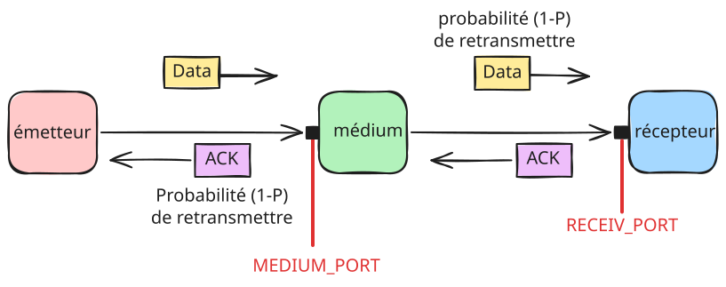

# Algorithmes des réseaux - Bit Alterné

Dans cet exercice, la liaison entre l'émetteur et le récepteur peut provoquer des pertes de message (__erreurs sur arrivée__).
L'objectif de ce TP est d'implémenter le modèle de communication du *bit alterné* présenté en cours et en TD, en utilisant un socket UDP, afin de fiabiliser la communication malgré les pertes provoquées par la liaison.
La liaison avec perte sera simulée par le programme `medium` déjà fourni.

La figure ci-dessous représente l'organisation de l'architecture logicielle pour la transmission des données.



## Objectifs

- Mettre en œuvre un mécanisme ARQ (*Automatic Repeat reQuest*) pour assurer la transmission fiable de données sur une liaison sujette à des pertes (erreurs sur arrivée).

## Commande d'exécution

Pour simplifier l'exécution des programmes, les adresses IP seront toutes fixées à l'adresse de boucle locale IPv6 (`::1`).
Les ports seront spécififés dans les variables d'environnement suivantes :

```sh
RECEIV_PORT    # port du récepteur
MEDIUM_PORT    # port du médium côté émetteur, on pourra laisser le système d'exploitation choisir le port )
```

Les ports de communication de l'émetteur et du médium vers le récepteur seront laissés à la discretion du système d'exploitation.

En conséquence, les programmes `abp-sender` et `abp-receiver` ne prennent pas d'argument.
Le programme `ab-sender` envoie les données lues depuis l'entrée standard, et le programme `abp-receiver` écrit les données reçues sur la sortie standard.

Le programme `medium` (déjà fourni) simule une liaison avec perte entre l'émetteur et le récepteur.
Lorsqu'il reçoit un message (des données depuis l'émetteur ou un acquittement depuis le récepteur), il retransmet ce message vers la destination finale avec une probabilité $P$ configurable.
Autrement dit, un message a une probabilité $(1 - P)$ d'être transmis correctement.

Le programme `medium` prend en argument le taux de perte $P$ (compris entre 0 et 1) :

```sh
./medium <taux_perte>
```

Le programme `medium` génère sur la sortie standard une __trace__ de chaque message reçu sous la forme suivante :

```
X->Y, seq=Z -> K
```

- `X` représente la source : `E` pour l'émetteur, `R` pour le récepteur.
- `Y` représente la destination : `E` pour l'émetteur, `R` pour le récepteur.
- `Z` représente le numéro de séquence du message (donnée ou acquittement).
- `K` indique si le message a été transmis ("transmis") ou perdu ("perte").

La génération de ces traces vous permettra de vérifier le bon déroulement de la transmission et de la perte des messages en fonction du taux de perte.

## Marche  à suivre

### Programme émetteur

Par rapport à l'exercice précédent, l'émetteur doit désormais numéroter les messages envoyés modulo 2.
Pour ce faire, vous devez utiliser la structure `struct message` définie dans le fichier `common.h`.

L'émetteur doit également utiliser un temporisateur sur la réception des acquittements afin de détecter la perte d'un message (de données ou d'un acquittement).
Pour ce faire, vous pouvez configurer le socket pour que la lecture ne soit plus bloquante après expiration d'un délai prédéfini sans réception de données.
Cette configuration est identique à celle réalisée dans l'exercice 2 pour gérer la terminaison du récepteur.
Ici, lorsque le temporisateur expire, il faut retransmettre le message courant.

### Programme récepteur

Le programme `abp-receiver` est pratiquement identique au programme `sw-receiver` de l'exercice précédent.
Désormais, après réception d'un message, le récepteur doit indiquer à l'émetteur le numéro du message qu'il attend suite à cette réception.
Vous pouvez également utiliser ici le format de message défini dans le fichier `common.h`.

## Test des programmes

Il vous faut trois terminaux (un par programme) pour tester vos programmes avec les commandes suivantes :

- Définissez les variables d'environnement pour les ports de communication :

```sh
export RECEIV_PORT= # port de votre choix 
export MEDIUM_PORT= # port de votre choix 
```

- Lancez le récepteur dans le premier terminal :

```sh
./abp-receiver > titi
```

- Lancez le médium dans le second terminal (ici $P = 0,3$) :

```sh
./medium 0.3
```

- Enfin, lancez les commandes suivantes dans un troisième terminal :

```sh
dd if=/dev/random of="toto" bs=8k count=2 2> /dev/null
./sender-udp < toto
```

À la fin de l'exécution du programme `abp-sender`, quittez les programmes `medium` et `abp-receiver`, puis vérifiez que les fichiers `toto` et `titi` sont identiques :

```sh
cmp toto titi
```

## Questions

1. Pourquoi le bit alterné n'utilise-t-il qu'un seul bit pour les numéros de séquence ? Que se passerait-il si on utilisait deux bits sans changer le reste ?
2. Y a-t-il un risque d'interblocage si le récepteur n'envoie d'acquittement que pour le message qu'il attend et ignore les duplicatas ?
3. Quelle incidence a une valeur trop faible pour le temporisateur ?
4. Doit-on numéroter les acquittements si la liaison est half-duplex ? Et si la liaison est full-duplex ?

## Validation

Votre programme doit réussir tous les tests sur GitLab avant de passer à l'exercice suivant.
Pour cette validation à distance, il faut `commit/push` votre fichier source sur le dépôt, ce qui déclenchera le *pipeline* de compilation et de tests.
